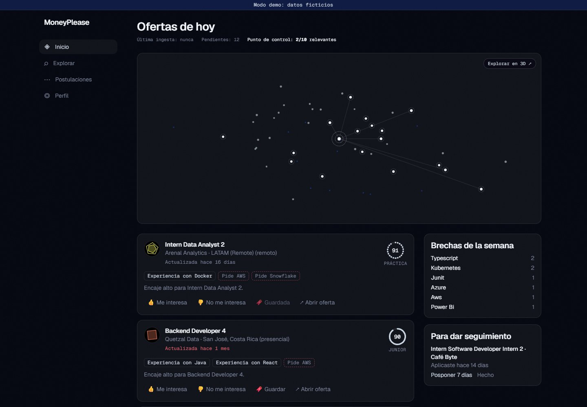
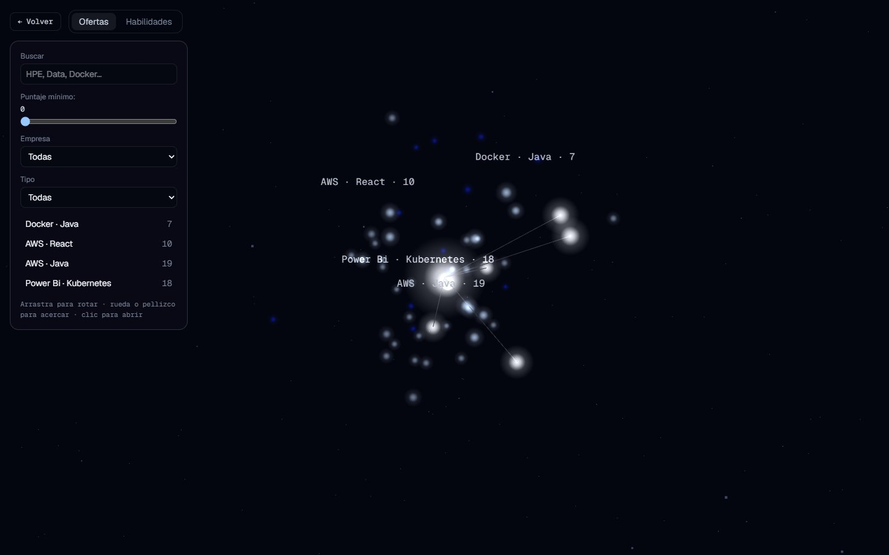
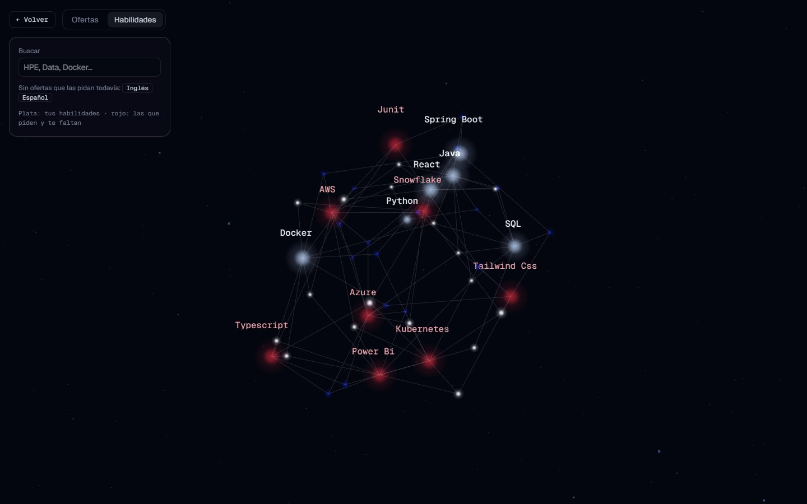
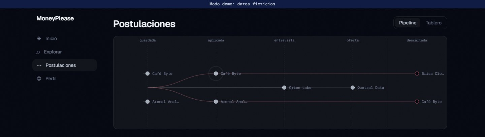
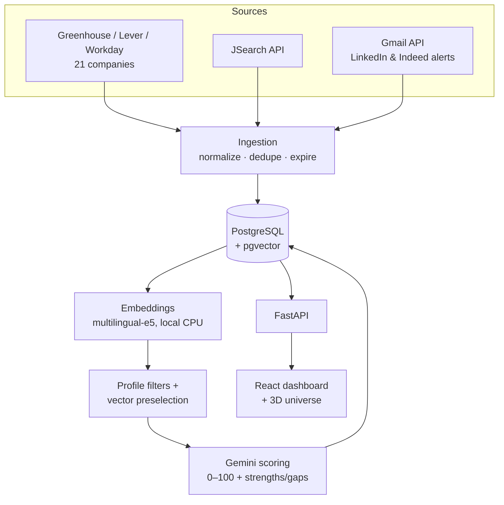

# MoneyPlease

**A personal job-matching platform for internships and junior roles in Costa Rica.** Twice a day it collects postings from 23 sources, filters them by location and seniority, and ranks each one against a CV-based profile using vector embeddings and an LLM, so the best matches show up first in a dashboard.



<sub>Screenshots use the built-in demo mode, with fictional companies and data.</sub>

## What it does

- **Ingests ~2,500 active postings** from 21 company career sites (Greenhouse, Lever and Workday public APIs), the JSearch API, and LinkedIn/Indeed alert emails read through the Gmail API.
- **Normalizes and deduplicates** them: location and work mode detection (on-site / hybrid / remote) in English and Spanish, near-duplicate grouping by embedding similarity, and automatic expiry when a posting disappears from its source.
- **Matches** each new posting against the profile in two stages: a cheap vector search with pgvector preselects the most similar ones, and Gemini scores those (0–100) with strengths, gaps and a summary. Thumbs up/down feedback is fed back as few-shot examples.
- **Shows it all in a dashboard**: ranked offers, a semantic map, an application pipeline with a kanban board, a skill-gap graph, and an explorable 3D "universe" of offers and skills.

| Offers universe | Skills universe |
|---|---|
|  |  |



## How it works



- A scheduler runs ingestion and matching at 6:00 and 18:00 (Costa Rica time); each source fails independently and is retried on the next run.
- Embeddings are computed locally, so only the shortlisted postings reach the LLM, which keeps it within Gemini's free tier.
- **Privacy:** the CV is redacted (no name, emails, phones or links) before any text is sent to the LLM, and personal files, tokens and keys stay out of the repository.
- **Legal sources only:** public ATS APIs, an official job-search API and the user's own alert emails; Workday sites are only read when their `robots.txt` allows it.

## Tech stack

| Area | Tools |
|---|---|
| Backend | Python 3.12, FastAPI, SQLAlchemy 2, Alembic, APScheduler, uv |
| Data | PostgreSQL 16, pgvector, sentence-transformers (`multilingual-e5-small`), NumPy |
| AI | Gemini API (structured JSON output), embeddings, few-shot feedback |
| Frontend | React 19, TypeScript, Vite, Tailwind CSS 4, TanStack Query, D3, three.js |
| Infra & quality | Docker Compose, GitHub Actions CI, pytest + testcontainers, Vitest + MSW — 500+ automated tests |

## Running it

```bash
cp .env.example .env          # add GEMINI_API_KEY, and optionally JSEARCH_API_KEY
docker compose up -d --build  # db + worker + web on http://localhost:8000
```

To try the dashboard without any personal data:

```bash
docker compose exec web python -m moneyplease demo seed
DEMO_MODE=true docker compose up -d web
```

Full setup (data sources, Gmail alerts, profile from a CV, phone access with Tailscale) is documented in Spanish in [docs/INSTALACION.md](docs/INSTALACION.md), and day-to-day use in [docs/USO.md](docs/USO.md). The design of each phase is in [docs/superpowers/specs](docs/superpowers/specs).

## Tests

```bash
cd backend && uv run pytest
cd frontend && npm test && npm run typecheck && npm run build
```

Database tests spin up PostgreSQL with pgvector through testcontainers; no test touches the network. CI runs both suites on every push.

---

Built by [Alexander Fallas Sanabria](https://www.linkedin.com/in/alexander-fallas-sanabria), Business Computing student at the University of Costa Rica.
